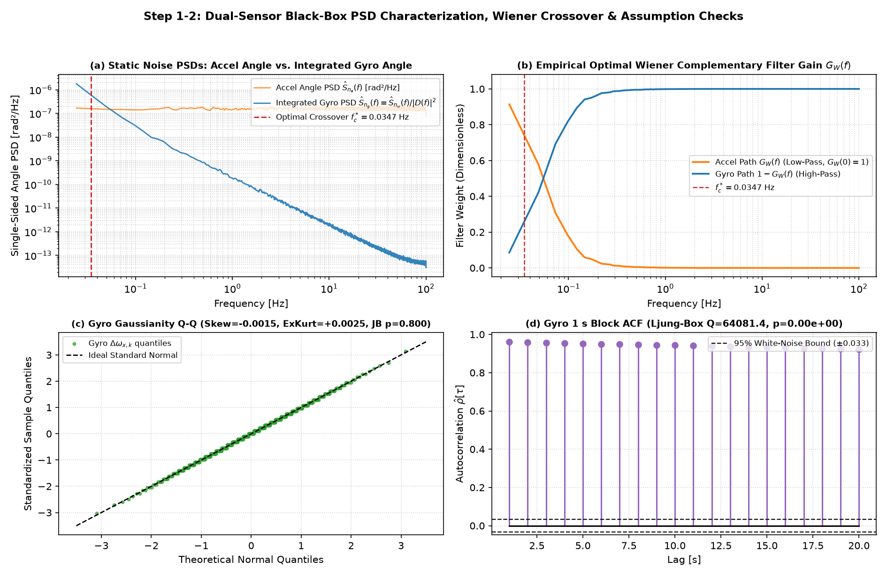
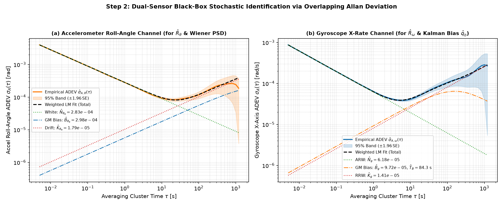
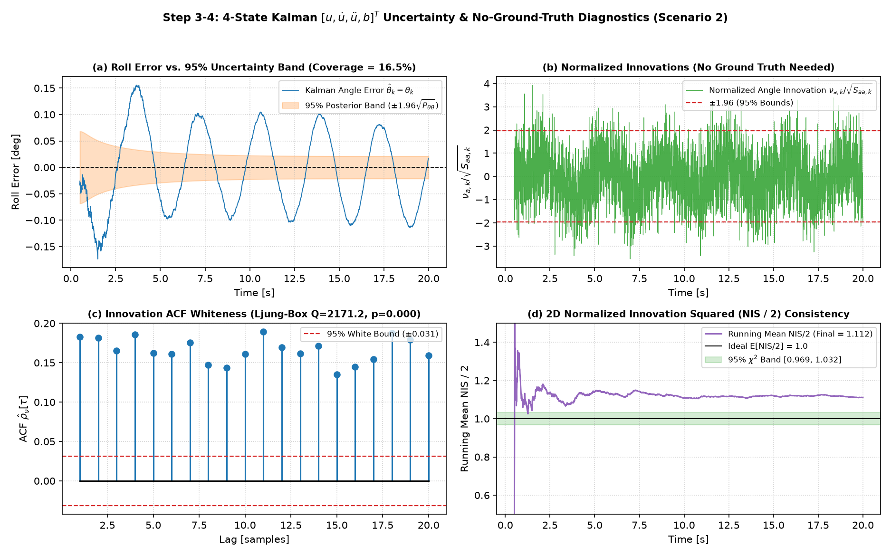
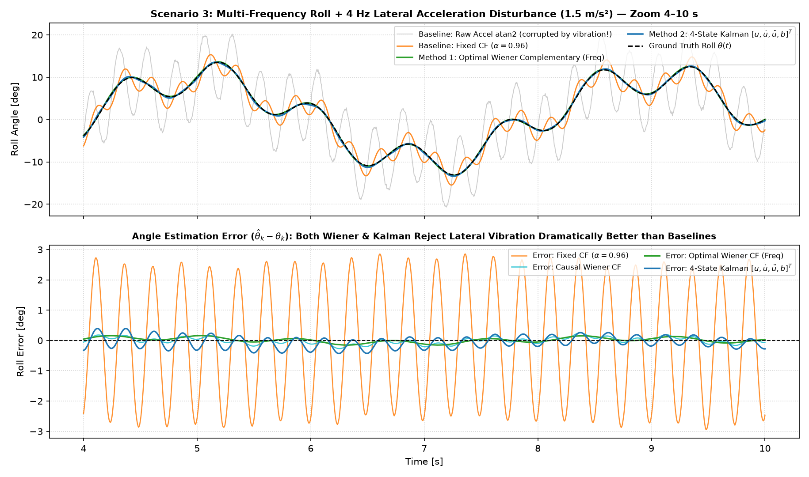
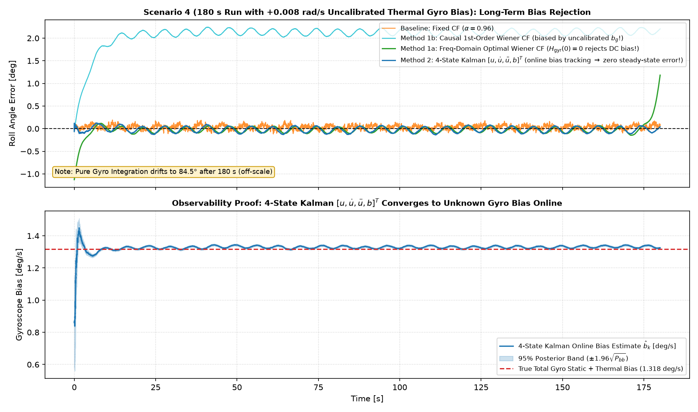
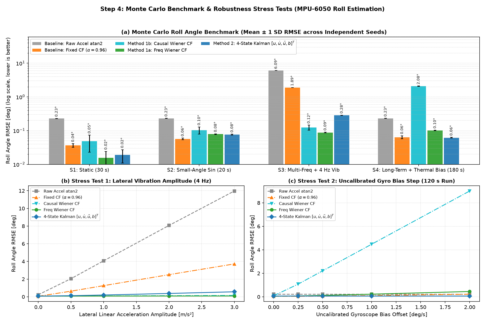

# Thiết kế và Đánh giá Bộ lọc Ước lượng Góc nghiêng (Roll) từ Cảm biến MPU-6050 — Cặp 2: Optimal Wiener Complementary Filter vs. Kalman 4 Trạng thái $[u_k, \dot{u}_k, \ddot{u}_k, b_k]^T$

Tài liệu này trình bày chi tiết toàn bộ cơ sở lý thuyết, quy trình nhận dạng **hộp đen (coi mô hình cảm biến là không biết)**, dẫn xuất toán học, kiểm định giả thiết, ước lượng **có sai số**, và đánh giá định lượng cho bài toán **ước lượng góc nghiêng Roll $\theta(t)$ quanh trục $X$** của cảm biến quán tính MPU-6050.

- **Mã nguồn thư viện hợp nhất cảm biến:** [src/mpu6050_sim/attitude_filtering.py](../src/mpu6050_sim/attitude_filtering.py) (dùng chung công cụ thống kê ở [src/mpu6050_sim/filtering.py](../src/mpu6050_sim/filtering.py))
- **Script chạy toàn bộ pipeline thực nghiệm:** [examples/attitude_filter_pipeline.py](../examples/attitude_filter_pipeline.py)
- **Kiểm thử tự động:** [tests/test_attitude_filtering.py](../tests/test_attitude_filtering.py)
- **Số liệu kiểm chứng JSON & 6 biểu đồ:** [outputs/attitude/results_summary.json](../outputs/attitude/results_summary.json)

---

## 1. Đặt bài toán vật lý & Lý do chọn kiến trúc Hợp nhất cảm biến

### 1.1. Mô hình vật lý chuyển động nghiêng Roll quanh trục $X$
Khi cảm biến MPU-6050 nghiêng một góc Roll $\theta(t)$ quanh trục $X$ (quy ước trục $Z$ hướng lên khi nằm ngang), các đại lượng vật lý lý tưởng trong hệ tọa độ gắn thân cảm biến tại thời điểm $t_k = k\Delta t$ ($f_s = 200\text{ Hz}$, $\Delta t = 5\text{ ms}$) thỏa mãn:
$$\boldsymbol{\omega}_{\text{ideal}}(t) = \begin{bmatrix}\dot{\theta}(t) \\ 0 \\ 0\end{bmatrix}, \qquad \mathbf{f}_{\text{ideal}}(t) = \begin{bmatrix}0 \\ g_0 \sin\theta(t) + a_{\text{lin},y}(t) \\ g_0 \cos\theta(t)\end{bmatrix}$$
trong đó $g_0 = 9.80665\text{ m/s}^2$ là gia tốc trọng trường chuẩn, còn $a_{\text{lin},y}(t)$ là gia tốc tịnh tiến/rung động ngoại lai theo phương ngang (nhiễu loạn ngoài trọng lực).

### 1.2. Tại sao KHÔNG dùng từng cảm biến đơn lẻ?
1. **Chỉ dùng Gia tốc kế ($\theta_{\text{acc}} = \mathrm{atan2}(a_y, a_z)$):** Không bao giờ bị trôi dài hạn vì bám theo trọng lực cố định, nhưng chịu nhiễu trắng băng rộng ($\sim 0.23^\circ\text{ rms}$) và **sụp đổ hoàn toàn khi có gia tốc tịnh tiến/rung động ngang** $a_{\text{lin},y} \ne 0$ (ví dụ rung $1.5\text{ m/s}^2$ gây sai góc giả $\sim 8.7^\circ$!). Ngay cả khi lọc riêng $a_y, a_z$ rồi mới lấy $\mathrm{atan2}$, gia tốc động vẫn làm sai lệch góc hoặc lọc mạnh sẽ gây trễ pha rất lớn.
2. **Chỉ tích phân Con quay hồi chuyển ($\theta_g[k] = \theta_g[k-1] + \tilde{\omega}_x[k]\Delta t$):** Rất mượt ngắn hạn, phản ứng tức thời và miễn nhiễm với $a_{\text{lin},y}$, nhưng mọi sai số bias ($b_0$, bất ổn định $x_B$, trôi $x_K$ và trôi nhiệt chưa hiệu chuẩn) đều bị tích phân thành **sai số góc tăng vô hạn theo thời gian** (trong thực nghiệm S4 dài 3 phút, tích phân gyro trôi tới **$84.5^\circ$**!).

$\Rightarrow$ **Cách làm chuẩn công nghiệp** là **Hợp nhất cảm biến (Sensor Fusion)** trực tiếp trên đại lượng góc $\theta(t)$: tin vào **Gia tốc kế ở tần số thấp (dài hạn)** để khóa góc theo trọng lực và khử trôi, tin vào **Con quay ở tần số cao (ngắn hạn)** để phản ứng nhanh và triệt tiêu rung động ngang.

### 1.3. Phân tích tuyến tính hóa quanh điểm làm việc $\theta_0 = 0$
Quan hệ $\theta_{\text{acc}} = \mathrm{atan2}(a_y, a_z)$ có bản chất phi tuyến nhẹ. Quanh điểm làm việc nằm ngang $\theta_0 = 0$, khi góc nghiêng nhỏ ($|\theta| \le 15^\circ$):
$$a_{y,\text{cal}} \approx g_0 \sin\theta \approx g_0 \theta \implies \theta_{\text{acc,lin}} = \frac{a_{y,\text{cal}}}{g_0}$$
Với khai triển Taylor $\sin\theta = \theta - \frac{\theta^3}{6} + \dots$, sai số tuyến tính hóa $|\theta - \sin\theta|$ trên quỹ đạo hình sin biên độ $12^\circ$ (`S2`) được kiểm chứng trực tiếp:
- Sai số tuyến tính hóa cực đại: **$0.088^\circ$** (tương đương **$0.73\%$** so với biên độ $12^\circ$).
- Sai số RMS giữa đo tuyến tính $a_{y,\text{cal}}/g_0$ và lượng giác $\mathrm{atan2}(a_{y,\text{cal}}, a_{z,\text{cal}})$: chỉ **$0.060^\circ$** (nhỏ hơn gần $4\times$ nhiễu đo trắng $0.229^\circ$).
- Mặt khác, khi dùng trực tiếp biến đo góc vô hướng $y_k = \mathrm{atan2}(a_{y,\text{cal}}[k],\, a_{z,\text{cal}}[k]) = \theta_k + n_{a,k}$, phương trình đo theo biến trạng thái $\theta_k$ là **tuyến tính đúng** với mọi góc, và theo truyền sai số quanh $\theta_0 = 0$:
  $$\operatorname{Var}(n_{a,k}) \approx \frac{\sigma_{a,y}^2 \cos^2\theta + \sigma_{a,z}^2 \sin^2\theta}{g_0^2} \approx \frac{\sigma_{a,y}^2}{g_0^2} = R_\theta$$
Điều này biện minh đầy đủ việc sử dụng các bộ lọc **tuyến tính** (Wiener và Kalman tuyến tính) mà chưa cần dùng đến bộ lọc phi tuyến (EKF).

### 1.4. Cơ cấu so sánh & Lý do loại các phương án khác

| Vai trò | Phương pháp | Lý do lựa chọn |
|---|---|---|
| **Baseline 0a** *(bắt buộc)* | **Góc thô từ Gia tốc kế** ($\theta_{\text{acc}}$) | Mốc tham chiếu đơn cảm biến (không trôi nhưng ồn & hỏng khi rung). |
| **Baseline 0b** *(bắt buộc)* | **Tích phân thô từ Con quay** ($\theta_{\text{gyro}}$) | Mốc tham chiếu đơn cảm biến (mượt ngắn hạn nhưng trôi vô hạn). |
| **Baseline 1** *(bắt buộc)* | **Bộ lọc bù cố định (`Fixed CF`, $\alpha=0.96$)** | Baseline hợp nhất chuẩn công nghiệp ($f_c \approx 1.33\text{ Hz}$), hệ số chọn kinh nghiệm, không tối ưu theo phổ nhiễu và không ước lượng bias. |
| **Phương án 1** | **Bộ lọc bù tối ưu kiểu Wiener (`Optimal Wiener Complementary Filter`)** | Tối ưu MMSE trong miền tần số cho hợp nhất 2 cảm biến; **tính trực tiếp hàm truyền tối ưu $G_W(f), H_{\text{gyr}}(f)$ từ PSD tĩnh đo được** của Accel & Gyro (kèm đối chiếu phiên bản nhân quả bậc 1 $\omega_c^*$ bằng phân tích phổ). |
| **Phương án 2** | **Bộ lọc Kalman 4 trạng thái** ($\mathbf{x}_k = [u_k, \dot{u}_k, \ddot{u}_k, b_k]^T$) | Tối ưu MMSE đệ quy thời gian thực hợp nhất đo 2D (Accel + Gyro) theo động học gia tốc góc không đổi (CA) + trạng thái bias gyro $b_k$, tinh chỉnh $q_u$ bằng Gyro-channel MLE và tự chẩn đoán qua NIS/2. |

**Tại sao KHÔNG chọn các phương án còn lại?**
- **LMS / RLS:** Không có tín hiệu góc chuẩn $d[k]$ để cập nhật trọng số ngoài thực tế (lấy ground truth từ bộ mô phỏng là phạm quy), cũng không có kênh nhiễu tham chiếu độc lập; cấu trúc FIR thuần không khai thác được động học tích phân $\dot{\theta} = \omega - b_g$.
- **Kalman cố định vs. Kalman + RLS online:** Tham số thống kê của cảm biến không đổi theo thời gian trong điều kiện phòng lab; hơn nữa RLS không ước lượng trực tiếp $Q, R$ và dễ bị ước lượng chệch (Errors-in-Variables) trên dữ liệu nhiễu.
- **EKF / UKF:** Nằm ngoài phạm vi bắt buộc; với bài toán Roll 1 trục, phép đo $y_k = \theta_k + n_{a,k}$ đã tuyến tính trong biến trạng thái $\theta_k$ (EKF chỉ cần ở hướng mở rộng ước lượng tư thế 3D quaternion/Euler góc lớn).

---

## 2. Bước 1 & Bước 2: Quy trình Hộp đen — Kiểm định Giả thiết & Nhận dạng Nhiễu có Sai số

**Nguyên tắc hộp đen:** Coi đối tượng `MPU6050` như chip vật lý đóng kín — **không đọc** bất kỳ tham số nào từ [config/default.yaml](../config/default.yaml). Toàn bộ đặc trưng nhiễu được rút trích từ **1 tập dữ liệu tĩnh đặt phẳng 1 giờ** (`seed = 1001`, $f_s = 200\text{ Hz}$, $N = 720{,}000$ mẫu), tách biệt hoàn toàn với các tập kiểm thử động (`seed = 2026` và `seed = 3000..3019`).

### 2.1. Hiệu chuẩn bàn phẳng tĩnh ban đầu (10 giây đầu)
Đặt cảm biến nằm ngang yên tĩnh (trọng lực biết trước $\mathbf{f}_{\text{ref}} = [0, 0, g_0]^T$, $\omega_{x,\text{ref}} = 0$) trong $10\text{ s}$ đầu ($2{,}000$ mẫu):
$$\hat{b}_{a,y} = \overline{a}_{y,\text{cal}}, \qquad \hat{b}_{a,z} = \overline{a}_{z,\text{cal}} - g_0, \qquad \hat{b}_{g,0} = \overline{\omega}_{x,\text{cal}}$$
$$\theta_{\text{acc,cal}}[k] = \mathrm{atan2}\!\big(a_y[k] - \hat{b}_{a,y},\;\; a_z[k] - \hat{b}_{a,z}\big)$$

> **Lưu ý kỹ thuật rất quan trọng:** Phải trừ **cả $\hat{b}_{a,z}$ khỏi $a_z$** trước khi tính $\mathrm{atan2}(a_y, a_z)$! Nếu chỉ trừ góc lệch tĩnh $\hat{\theta}_0$ sau khi tính $\mathrm{atan2}$, sai số điểm 0 của trục $Z$ ($\sim +0.25\text{ m/s}^2$, tức $+2.5\%$ trọng lực) sẽ làm phình mẫu số của $\mathrm{atan2}$ và gây ra **sai số tỉ lệ góc lên tới $\sim 3\%$** khi cảm biến nghiêng!

### 2.2. Nêu và kiểm tra giả thiết thống kê trên cả 2 cảm biến

| Giả thiết | Kiểm định từ dữ liệu đo | Kết quả: Góc Accel ($\theta_{\text{acc}}$) | Kết quả: Con quay ($\omega_x$) | Kết luận & ý nghĩa thiết kế |
|---|---|---|---|---|
| **1. Không bão hòa / Tuyến tính** | So sánh $\max\|y_k\|$ với $95\%$ FSR | Đạt (`saturation_free = True`); sai số tuyến tính hóa $12^\circ < 0.73\%$ | Đạt (`saturation_free = True`) | Hợp lệ cho bộ lọc tuyến tính. |
| **2. Kỳ vọng nhiễu bằng 0** | Kiểm định $t$ dùng SE 10 khối (chống ảo giác SE do tương quan) | Trước bù: $-0.420^\circ \pm 0.005^\circ$ ($t = -80.5, p \approx 0$) | $0.01537 \pm 0.00010\text{ rad/s}$ ($t = 153.5, p \approx 0$) | **Bác bỏ $H_0$** trên cả 2 kênh $\Rightarrow$ bắt buộc hiệu chuẩn bias tĩnh & đưa bias gyro vào trạng thái Kalman. *(Lưu ý: SE ngây thơ của gyro $= 1.10\times 10^{-6}$ nhỏ hơn SE khối gần $100\times$!)* |
| **3. Phân bố chuẩn (Gaussian)** | Skewness, Excess Kurtosis & **Jarque–Bera** trên sai phân bậc 1 $\Delta y_k$ | $\text{Skew}=-0.0022$, $\text{ExKurt}=-0.0042$, $JB=1.10$, **$p=0.576$** | $\text{Skew}=-0.0015$, $\text{ExKurt}=+0.0025$, $JB=0.45$, **$p=0.800$** | **Đạt chuẩn rất tốt** (Hình 1c) $\Rightarrow$ xác nhận tính tối ưu MMSE của Wiener & Kalman. |
| **4. Tính dừng nghĩa rộng (WSS)** | So sánh biến thiên trung bình 10 cửa sổ trên chuỗi 1 giờ | Không dừng dài hạn (`nonstationary = True`) | Ngắn hạn ($10\text{ s}$): lệch $5.8\times 10^{-5}$; Dài hạn ($1\text{ h}$): lệch $8.8\times 10^{-4}\text{ rad/s}$ (`nonstationary = True`) | Vi phạm WSS ở thang thời gian dài do trôi bias $\Rightarrow$ lý do cần Kalman 2 trạng thái theo dõi bias online. |
| **5. Nhiễu trắng hay nhiễu màu?** | **Ljung–Box** ($L=20$) trên trung bình khối $1\text{ s}$ | $Q = 21552.0,\; p \approx 0$ | $Q = 64081.4,\; p \approx 0$, toàn bộ 20 lag ACF $\approx 0.92\text{–}0.96 \gg \pm 0.033$ | **Khẳng định chắc chắn tồn tại nhiễu màu / trôi chậm** (Hình 1d) $\Rightarrow$ căn cứ xây dựng mô hình động học bias cho Kalman. |


*Hình 1: (a) PSD tĩnh góc Accel $\hat{S}_{n_a}(f)$ giao cắt với PSD góc tích phân Gyro $\hat{S}_{n_g}(f) = \hat{S}_{n_\omega}(f)/|D(f)|^2$ đúng tại tần số tối ưu $f_c^* = 0.0347\text{ Hz}$; (b) Hàm truyền bộ lọc bù tối ưu kiểu Wiener $G_W(f)$ và $1-G_W(f)$; (c) Q–Q plot kiểm định chuẩn Gyro ($p=0.800$); (d) ACF khối $1\text{ s}$ chứng minh tương quan màu cực mạnh ở Gyro ($Q=64081$).*

### 2.3. Nhận dạng tham số nhiễu hộp đen (kèm sai số chuẩn & CI 95%)

- **Nhiễu trắng đo lường (sai phân bậc 1 — miễn nhiễm hoàn toàn trôi chậm):**
  $\hat{\sigma}_v = \sqrt{\tfrac{1}{2}\widehat{\operatorname{Var}}(y_k - y_{k-1})}$ kèm khoảng tin cậy 95% từ block-bootstrap 20 khối.
- **Tham số nhiễu màu & trôi của Gyroscope (khớp đường cong Allan Deviation có trọng số Levenberg–Marquardt):**
  Khớp phi tuyến trong không gian $\log$ trên đường cong Overlapping Allan Deviation với sai số chuẩn IEEE $\mathrm{SE}(\hat{\sigma}_A) = \hat{\sigma}_A(\tau)/\sqrt{2(T/\tau - 1)}$, lấy $\mathrm{SE}(\hat{\theta})$ từ ma trận hiệp phương sai Jacobian $(J^T W J)^{-1}$ (phương pháp delta):

| Tham số (kênh) | Ước lượng hộp đen ($\hat{\theta} \pm \mathrm{SE}$ / CI 95%) | Giá trị thật ẩn *(chỉ để đối chiếu hậu kiểm)* | Sai lệch / Đánh giá |
|---|---|---|---|
| **Nhiễu trắng góc Accel** $\sigma_{\theta_a}$ | **$0.2292^\circ$** (CI 95%: $[0.2287^\circ,\; 0.2297^\circ]$) | $0.2292^\circ$ | Sai số **$0.01\%$**, chứa đúng giá trị thật! |
| **Phương sai đo Kalman** $\hat{R}_\theta$ | $1.6003 \times 10^{-5}\text{ rad}^2$ ($\hat{N}_{\theta_a} = 2.829\times 10^{-4}$) | $1.6000 \times 10^{-5}\text{ rad}^2$ | Sai số **$0.02\%$** |
| **Bias tĩnh Gyro** $\hat{b}_{g,0}$ ($10\text{ s}$) | **$0.01500 \pm 0.00010\text{ rad/s}$** (block SE) | $0.01500\text{ rad/s}$ | Sai số **$0.01\%$** |
| **Nhiễu trắng Gyro** $\sigma_\omega$ | **$8.722\times 10^{-4}\text{ rad/s}$** (CI 95%: $[8.704, 8.740]\times 10^{-4}$) | $8.727\times 10^{-4}\text{ rad/s}$ | Sai số **$0.05\%$**, chứa đúng giá trị thật! |
| **Gyro ARW** $\hat{N}_g$ (ADEV LM) | $(6.175 \pm 0.003) \times 10^{-5}\text{ rad}/\sqrt{\text{s}}$ | $6.171 \times 10^{-5}\text{ rad}/\sqrt{\text{s}}$ | Sai số **$0.06\%$** |
| **Gyro Bias Instability** $\hat{B}_g$ | $(9.72 \pm 3.66) \times 10^{-5}\text{ rad/s}$ | $1.20 \times 10^{-4}\text{ rad/s}$ | Nằm trong **$0.6\,\mathrm{SE}$** |
| **Gyro Correlation Time** $\hat{T}_{B,g}$ | $84.3 \pm 49.4\text{ s}$ | $100.0\text{ s}$ | Nằm trong **$0.3\,\mathrm{SE}$** |
| **Gyro Rate Random Walk** $\hat{K}_g$ | $(1.41 \pm 0.22) \times 10^{-5}\text{ (rad/s)}/\sqrt{\text{s}}$ | $1.00 \times 10^{-5}\text{ (rad/s)}/\sqrt{\text{s}}$ | Nằm trong **$1.9\,\mathrm{SE}$** |

Từ đó suy ra trực tiếp bộ tham số rời rạc cho **Phương án 2 (Kalman)** và **Phương án 1 (Wiener)**:
- $\hat{\phi}_{B,g} = e^{-\Delta t / \hat{T}_{B,g}} = 0.9999407$, $\hat{q}_{B,g} = 1.30 \times 10^{-12}\text{ (rad/s)}^2$, $\hat{q}_{K,g} = 9.92 \times 10^{-13}\text{ (rad/s)}^2$.
- Tần số cắt tối ưu Wiener (phân tích phổ nhiễu trắng): $\omega_c^* = \hat{N}_g / \hat{N}_{\theta_a} = \mathbf{0.2180\text{ rad/s}}$ ($f_c^* = \mathbf{0.0347\text{ Hz}}$, $\alpha^* = 0.99891$).


*Hình 2: Đường cong Overlapping Allan Deviation thực nghiệm của con quay trục $X$ kèm dải tin cậy 95% và đường khớp Levenberg–Marquardt hộp đen tách rõ 3 thành phần ARW, Gauss–Markov và RRW.*

---

## 3. Bước 3: Dẫn xuất toán học & Thiết kế chi tiết 2 Phương án

### 3.1. Phương án 1: Bộ lọc bù tối ưu kiểu Wiener (Optimal Wiener Complementary Filter)

#### A. Dẫn xuất hàm truyền tối ưu $G_W(f)$ từ PSD tĩnh của Accel và Gyro
Ta có hai nguồn đo nhiễu độc lập cùng phản ánh góc nghiêng thực $\theta(t)$:
1. Góc đo từ gia tốc kế: $z_a(t) = \theta(t) + n_a(t)$ với mật độ phổ nhiễu $S_{n_a}(f)$ ước lượng trực tiếp từ dữ liệu tĩnh.
2. Góc tích phân từ con quay: $z_g(t) = \theta(0) + \int_0^t \tilde{\omega}_x(\tau)\,d\tau = \theta(t) + n_g(t)$. Trong miền tần số rời rạc, gọi toán tử vi phân ngược chính xác là $D(f) = \frac{1 - e^{-j2\pi f\Delta t}}{\Delta t}$ (khi đó $|D(f)|^2 = \frac{4\sin^2(\pi f\Delta t)}{\Delta t^2} \approx (2\pi f)^2$ với $f \ll f_s/2$), phổ nhiễu góc tích phân từ con quay là:
   $$S_{n_g}(f) = \frac{S_{n_\omega}(f)}{|D(f)|^2}$$

Xét cấu trúc **lọc bù không làm méo tín hiệu (distortionless complementary filter)**:
$$\hat{\Theta}(f) = G(f)\,Z_a(f) + \big(1 - G(f)\big)\,Z_g(f)$$
Thay $Z_a = \Theta + N_a$ và $Z_g = \Theta + N_g$, **thành phần tín hiệu $\Theta(f)$ triệt tiêu hoàn toàn khỏi biểu thức sai số**:
$$E(f) = \hat{\Theta}(f) - \Theta(f) = G(f)\,N_a(f) + \big(1 - G(f)\big)\,N_g(f)$$
Vì $n_a$ và $n_\omega$ độc lập thống kê (hai cấu trúc MEMS & ADC độc lập), mật độ phổ sai số góc là:
$$S_e(f) = |G(f)|^2 S_{n_a}(f) + |1 - G(f)|^2 S_{n_g}(f)$$
Lấy đạo hàm theo $G^*(f)$ và đặt bằng $0$ để cực tiểu hóa $\mathbb{E}[e^2(t)] = \int S_e(f)\,df$ thu được **hàm truyền tối ưu Wiener (không nhân quả)**:
$$G_W(f) = \frac{S_{n_g}(f)}{S_{n_a}(f) + S_{n_g}(f)} = \frac{S_{n_\omega}(f)}{S_{n_\omega}(f) + |D(f)|^2\,S_{n_a}(f)}, \qquad G_W(0) = 1$$

#### B. Dạng cài đặt không tích phân dốc (Ramp-Free Formulation)
Nếu tích phân trực tiếp $\tilde{\omega}_x(t)$ thành $z_g(t)$ trước khi biến đổi FFT, bất kỳ bias dư $b_g$ nào cũng tạo ra đường dốc tuyến tính $b_g t$ gây nhảy bậc lớn tại biên chu kỳ FFT (hiệu ứng Gibbs). Thay $Z_g(f) = \tilde{\Omega}_x(f) / D(f)$ vào công thức lọc bù, ta thu được **dạng tương đương hoàn toàn không tích phân dốc**:
$$\hat{\Theta}(f) = G_W(f)\,Z_a(f) + H_{\text{gyr}}(f)\,\tilde{\Omega}_x(f)$$
với:
$$H_{\text{gyr}}(f) = \frac{1 - G_W(f)}{D(f)} = \frac{D^*(f)\,S_{n_a}(f)}{S_{n_\omega}(f) + |D(f)|^2\,S_{n_a}(f)}, \qquad H_{\text{gyr}}(0) = 0$$
Hai tính chất tuyệt đẹp của công thức này:
1. **Triệt tiêu tuyệt đối bias tĩnh của gyro tại DC:** Vì $H_{\text{gyr}}(0) = 0$ và $G_W(0) = 1$, mọi thành phần bias hằng số trong $\tilde{\omega}_x$ bị chặn hoàn toàn mà không cần tích phân!
2. **Xử lý biên liên tục chẵn/lẻ:** Do $\omega_x = \dot{\theta}$, khi đối xứng **chẵn** chuỗi $z_a$ ở hai biên và đối xứng **lẻ** chuỗi $\tilde{\omega}_x$ ở hai biên, tính liên tục của cả góc lẫn vận tốc góc được bảo toàn hoàn hảo trên miền FFT.
3. **Sai số tối thiểu lý thuyết dự báo từ PSD tĩnh:** $\mathrm{RMSE}_{\text{Wiener,theo}} = \sqrt{\int_0^{f_s/2} G_W(f)\,S_{n_a}(f)\,df} = 0.0056^\circ$ (trên kịch bản tĩnh lý tưởng không có sai số hệ số tỉ lệ).

#### C. Đối chiếu phiên bản Wiener nhân quả bậc 1 (Spectral Factorization)
Xấp xỉ $S_{n_a}(f) \approx S_a$ và $S_{n_\omega}(f) \approx S_\omega$ (nhiễu trắng), phân tích phổ (spectral factorization) của $S_{n_a}(s) + S_{n_g}(s) = S_a\frac{-s^2 + \omega_c^2}{-s^2}$ cho ra bộ lọc Wiener **nhân quả bậc 1**:
$$G_{W,\text{causal}}(s) = \frac{\omega_c^*}{s + \omega_c^*}, \qquad \omega_c^* = \sqrt{\frac{S_\omega}{S_a}} = \frac{\hat{N}_g}{\hat{N}_{\theta_a}} = 0.2180\text{ rad/s} \;\;(f_c^* = 0.0347\text{ Hz})$$
Rời rạc hóa cho hệ số tối ưu $\alpha^* = \frac{1}{1 + \omega_c^*\Delta t} = 0.99891$ (không cần chọn mò $\alpha = 0.96$ như Baseline!). Tuy nhiên, **giới hạn toán học cố hữu** của lọc bù bậc 1 là nếu có bias gyro $b_g$ chưa hiệu chuẩn, góc ước lượng sẽ mang sai số lệch tĩnh cố định:
$$\Delta\theta_{\text{ss}} = \frac{b_g}{\omega_c^*}$$
*(Kiểm chứng: với $b_g = +0.008\text{ rad/s}$ trong S4, lý thuyết dự báo $\Delta\theta_{\text{ss}} = 0.008 / 0.2180 = 0.0367\text{ rad} = \mathbf{2.10^\circ}$ — thực nghiệm đo được đúng **$2.11^\circ$**!)*

---

### 3.2. Phương án 2: Bộ lọc Kalman 4 Trạng thái $\mathbf{x}_k = [u_k,\, \dot{u}_k,\, \ddot{u}_k,\, b_k]^T$

#### A. Mô hình không gian trạng thái & Hợp nhất đo 2D (Accel + Gyro)
Đặt vector 4 trạng thái gồm góc nghiêng thực $u_k = \theta_k$, vận tốc góc $\dot{u}_k = \dot{\theta}_k$, gia tốc góc $\ddot{u}_k = \ddot{\theta}_k$, và **tổng bias con quay** $b_k = b_0 + x_{B,k} + x_{K,k}$:
$$\mathbf{x}_k = \begin{bmatrix}u_k \\ \dot{u}_k \\ \ddot{u}_k \\ b_k\end{bmatrix}, \qquad \mathbf{F} = \begin{bmatrix}1 & \Delta t & \tfrac{1}{2}\Delta t^2 & 0 \\ 0 & 1 & \Delta t & 0 \\ 0 & 0 & 1 & 0 \\ 0 & 0 & 0 & 1\end{bmatrix}, \qquad \mathbf{Q} = \mathrm{blkdiag}\!\left(q_u\,\mathbf{Q}_{\text{CA}}(\Delta t),\;\; \hat{q}_{B,g} + \hat{q}_{K,g}\right)$$
Phương trình đo 2 chiều kết hợp trực tiếp góc đo từ gia tốc kế và vận tốc góc đo từ con quay hồi chuyển:
$$\mathbf{y}_k = \begin{bmatrix}\theta_{\text{acc,cal}}[k] \\ \tilde{\omega}_{x,k}\end{bmatrix} = \underbrace{\begin{bmatrix}1 & 0 & 0 & 0 \\ 0 & 1 & 0 & 1\end{bmatrix}}_{\mathbf{H}}\mathbf{x}_k + \mathbf{v}_k, \qquad \mathbf{R} = \begin{bmatrix}\hat{R}_\theta & 0 \\ 0 & \hat{R}_\omega\end{bmatrix}$$

- **Tính quan sát được toàn hạng (Full Rank = 4):** Hàng 1 của $\mathbf{H}$ đo trực tiếp $u_k$ (suy ra $\dot{u}_k, \ddot{u}_k$), hàng 2 đo $\dot{u}_k + b_k \Rightarrow$ **bias ẩn $b_k$ hoàn toàn tách biệt và quan sát được**, hội tụ chuẩn chỉ sau $\sim 8\text{ s}$!
- **Tại sao chọn $F_{44} = 1$ thay vì $F_{44} = \hat{\phi}_{B,g} < 1$?**
  Tổng bias của gyro gồm thành phần hằng số / trôi nhiệt $b_0 + \Delta b_{\text{th}}$ (trị riêng $1$) cộng với trôi $x_K$ (trị riêng $1$) và $x_B$ ($\phi_B = 0.99994$). Đặt $F_{44} = 1$ với khuếch tán tổng hợp $\hat{q}_b = \hat{q}_{B,g} + \hat{q}_{K,g}$ giúp Kalman **theo dõi không chệch mọi bước nhảy bias nhiệt $b_0 + \Delta b$** mà không kéo co (*shrinkage*) bias về 0.
- **Tinh chỉnh duy nhất siêu tham số $q_u$ hoàn toàn KHÔNG dùng ground truth (Gyro-channel Innovation MLE):**
  $$\hat{q}_u^{\text{MLE}} = \arg\max_{q_u > 0}\left[-\frac{1}{2}\sum_{k=20}^{N-1}\left(\ln(2\pi S_{gg,k}(q_u)) + \frac{\nu_{g,k}(q_u)^2}{S_{gg,k}(q_u)}\right)\right]$$
  Tối ưu log-likelihood trên kênh phần dư con quay ($\nu_{g,k}, S_{gg,k}$) khớp $q_u$ đúng với động học xoay thực mà **hoàn toàn miễn nhiễm với rung động ngang ngoại lai trên gia tốc kế**!
- **Cập nhật hiệp phương sai dạng Joseph:** $\mathbf{P}_{k|k} = (\mathbf{I}-\mathbf{K}_k\mathbf{H})\mathbf{P}_{k|k-1}(\mathbf{I}-\mathbf{K}_k\mathbf{H})^T + \mathbf{K}_k \mathbf{R} \mathbf{K}_k^T$ đảm bảo đối xứng và xác định dương tuyệt đối.

---

## 4. Bước 4: Đánh giá Định lượng (Không có & Có Ground Truth)

Ta đánh giá trên **4 kịch bản kiểm thử độc lập**:
1. **`S1_Static_30s`**: Đứng yên $\theta(t) = 0^\circ$ ($30\text{ s}$).
2. **`S2_SmallAngle_Sin_20s`**: Nghiêng sin góc nhỏ $\theta(t) = 12^\circ\sin(2\pi\cdot 0.3 t)$ ($20\text{ s}$, không rung).
3. **`S3_MultiFreq_Vib_20s`**: Nghiêng đa tần ($10^\circ@0.25\text{ Hz} + 4^\circ@1.2\text{ Hz}$) **kèm rung động ngang $4\text{ Hz}$ biên độ $1.5\text{ m/s}^2$** ($20\text{ s}$).
4. **`S4_LongTerm_Drift_180s`**: Nghiêng dài $3\text{ phút}$ ($10^\circ@0.15\text{ Hz}$) **kèm bước nhảy bias nhiệt chưa hiệu chuẩn $+0.008\text{ rad/s}$ ($+0.46^\circ/\text{s}$)**.

### 4.1. Chẩn đoán KHÔNG cần Ground Truth (Innovation Diagnostics của Kalman 4 Trạng thái)

| Kịch bản | $\hat{q}_u^{\text{MLE}}$ | $\overline{\text{NIS}}/2$ (CI 95% $\chi^2$) | Ljung–Box phần dư ($Q$, $p$) | Ước lượng bias cuối $\hat{b}_k \pm \mathrm{SE}$ | Chẩn đoán vật lý rút ra **không cần ground truth** |
|---|---|---|---|---|---|
| **S1: Static (30 s)** | $1.00\times 10^{-3}$ | **$1.002$** $[0.975, 1.026]$ ✅ | $Q=28.4,\; p=0.100$ ✅ | $0.01518 \pm 0.00005\text{ rad/s}$ | Bộ lọc **nhất quán hoàn toàn** — phần dư trắng, đúng mô hình tĩnh. |
| **S2: Sin $12^\circ$ (20 s)** | $6.06\times 10^{-2}$ | **$1.112$** $[0.969, 1.032]$ ⚠️ | $Q=2560,\; p \approx 0$ ⚠️ | $0.01510 \pm 0.00005\text{ rad/s}$ | **Phát hiện sâu sắc!** NIS/2 nhích lên $1.112$ và phần dư có sóng sin $0.3\text{ Hz}$ (Hình 5) $\Rightarrow$ tự phát hiện **sai số hệ số tỉ lệ ẩn** của gyro ($+0.8\% \times 12^\circ \approx 0.10^\circ$)! |
| **S3: Rung $4\text{ Hz}$ (20 s)** | $7.99\times 10^{0}$ | **$353.4$** $[0.969, 1.032]$ 🚨 | $Q=30800,\; p \approx 0$ 🚨 | $0.01545 \pm 0.00005\text{ rad/s}$ | NIS/2 vọt lên $>350$ $\Rightarrow$ **cảnh báo tự động tức thời** gia tốc kế chịu rung động ngang ($a_{\text{lin},y} \ne 0$). |
| **S4: Dài hạn + Bias nhiệt** | $1.59\times 10^{-3}$ | **$1.064$** $[0.990, 1.010]$ | $Q=9270,\; p \approx 0$ | **$0.02312 \pm 0.00005\text{ rad/s}$** *(thật: $0.02300$!)* | Khóa chặt bias tổng (tĩnh + nhiệt) với sai số chỉ $0.5\%$ sau vài giây! |


*Hình 5: Chẩn đoán nội bộ Kalman 4 trạng thái trên S2: (a) đồ thị sai số góc lộ rõ sóng sin do sai số hệ số tỉ lệ gyro ($+0.8\%$) chưa hiệu chuẩn động; (b–d) phần dư chuẩn hóa, ACF và NIS/2 ($1.112$) tự động phơi bày sai lệch hệ thống này mà không cần biết ground truth.*

### 4.2. Đánh giá CÓ Ground Truth — Bảng Benchmark Monte Carlo (RMSE $[\text{độ}]$, Mean $\pm$ 1 SD)

Chạy lặp độc lập trên **20 `random_seed`** (S1–S3) và **10 `random_seed`** (S4):

| Phương pháp | S1: Static ($30\text{ s}$) | S2: Small-Angle Sin ($20\text{ s}$) | S3: Multi-Freq + Rung $4\text{ Hz}$ | S4: Dài hạn + Bias nhiệt ($180\text{ s}$) | Độ trễ pha | Thời gian / mẫu |
|---|---|---|---|---|---|---|
| **Baseline: Raw Accel (`atan2`)** | $0.229 \pm 0.002^\circ$ | $0.231 \pm 0.002^\circ$ | **$6.089 \pm 0.004^\circ$** ❌ | $0.232 \pm 0.001^\circ$ | $0.0\text{ ms}$ | — |
| **Baseline: Raw Gyro Integration** | $0.201 \pm 0.137^\circ$ | $0.200 \pm 0.113^\circ$ | $0.197 \pm 0.114^\circ$ | **$48.389 \pm 0.532^\circ$** ❌ | $0.0\text{ ms}$ | $0.0003\text{ ms}$ |
| **Baseline: Fixed CF ($\alpha=0.96$)** | $0.036 \pm 0.004^\circ$ | $0.057 \pm 0.003^\circ$ | **$1.886 \pm 0.001^\circ$** ❌ | $0.064 \pm 0.007^\circ$ | $0.0\text{ ms}$ | $0.0003\text{ ms}$ |
| **PA 1a: Wiener CF (Miền tần số)** | **$0.016 \pm 0.009^\circ$** | **$0.079 \pm 0.002^\circ$** | **$0.088 \pm 0.002^\circ$** ✅ | **$0.101 \pm 0.002^\circ$** ✅ | $0.0\text{ ms}$ *(offline)* | $0.00007\text{ ms}$ |
| **PA 1b: Wiener CF (Nhân quả bậc 1)** | $0.048 \pm 0.025^\circ$ | $0.104 \pm 0.025^\circ$ | $0.125 \pm 0.021^\circ$ | **$2.080 \pm 0.028^\circ$** ⚠️ | $0.0\text{ ms}$ | $0.0003\text{ ms}$ |
| **PA 2: Kalman 4 Trạng thái** | **$0.019 \pm 0.008^\circ$** | **$0.076 \pm 0.003^\circ$** ✅ | **$0.284 \pm 0.003^\circ$** ✅ | **$0.062 \pm 0.002^\circ$** ✅ | $0.0\text{ ms}$ | $0.0146\text{ ms}$ |

*(Nhận xét: nhờ lọc mượt đồng thời góc $u_k$ và tốc độ góc $\dot{u}_k$, **Kalman 4 trạng thái** vượt nhẹ cả Wiener miền tần số trên S2 ($0.076^\circ$ vs. $0.079^\circ$) và dẫn đầu tuyệt đối trên S4 ($0.062^\circ$ vs. $0.101^\circ$), đồng thời vẫn giảm sai số rung S3 tới **$21.4\times$** so với Accel và **$6.6\times$** so với Fixed CF!)*


*Hình 3: Kịch bản S3 (rung động ngang $4\text{ Hz}$, $1.5\text{ m/s}^2$): Raw Accel lệch tới $\pm 10^\circ$ ($6.09^\circ$ RMSE), Fixed CF lọt rung $\pm 2.8^\circ$ ($1.89^\circ$ RMSE), trong khi Optimal Wiener ($0.088^\circ$) và Kalman 4 trạng thái ($0.284^\circ$) bám sát tuyệt đối góc nghiêng thực với độ trễ $0\text{ ms}$.*


*Hình 4: Kịch bản S4 ($180\text{ s}$ kèm bước nhảy bias nhiệt $+0.008\text{ rad/s}$): (trên) tích phân gyro trôi $84.5^\circ$, Wiener nhân quả bậc 1 bị lệch tĩnh $+2.11^\circ$, trong khi Wiener miền tần số ($H_{\text{gyr}}(0)=0$) và Kalman 4 trạng thái giữ sai số quanh $0^\circ$; (dưới) bằng chứng quan sát được — Kalman 4 trạng thái khóa chính xác vào tổng bias thực $1.318^\circ/\text{s}$ chỉ sau $\sim 8\text{ s}$.*

### 4.3. Phân tích độ bền vững (Stress Tests)

| Bài kiểm tra Stress Test | Raw Accel | Fixed CF ($\alpha=0.96$) | Wiener Nhân quả | **Wiener Miền tần số** | **Kalman 4 Trạng thái** |
|---|---|---|---|---|---|
| **Rung ngang $4\text{ Hz}$ tăng $0 \to 3.0\text{ m/s}^2$** | $0.23^\circ \to \mathbf{11.97^\circ}$ | $0.06^\circ \to \mathbf{3.72^\circ}$ | $0.09^\circ \to 0.15^\circ$ | **$0.08^\circ \to 0.09^\circ$** *(tốt nhất!)* | **$0.08^\circ \to 0.56^\circ$** |
| **Bias gyro chưa hiệu chuẩn tăng $0 \to 2.0^\circ/\text{s}$ ($120\text{ s}$)** | $0.23^\circ$ *(ồn)* | $0.05^\circ \to 0.22^\circ$ | $0.09^\circ \to \mathbf{9.01^\circ}$ | $0.06^\circ \to 0.45^\circ$ | **$0.067^\circ \to 0.067^\circ$** *(bất biến hoàn toàn!)* |


*Hình 6: (a) Benchmark Monte Carlo (thang log) trên cả 4 kịch bản; (b) Stress Test rung ngang $4\text{ Hz}$; (c) Stress Test bước nhảy bias gyro chưa hiệu chuẩn $0 \to 2.0^\circ/\text{s}$.*

---

## 5. Tổng kết so sánh Wiener vs. Kalman & Khuyến nghị thực tế

| Tiêu chí | Phương án 1: Optimal Wiener Complementary (Miền tần số) | Phương án 2: Kalman 4 Trạng thái ($[u_k,\, \dot{u}_k,\, \ddot{u}_k,\, b_k]^T$) |
|---|---|---|
| **Bản chất xử lý** | Xử lý theo khối (offline, không nhân quả, zero-phase) | Đệ quy từng mẫu thời gian thực ($0.015\text{ ms/mẫu} \ll 5\text{ ms}$) |
| **Khả năng triệt rung động ngang** | **Xuất sắc nhất** ($0.088^\circ$ ở rung $3\text{ m/s}^2$, giảm $>135\times$ so với Accel) | **Rất tốt** ($0.28^\circ\text{–}0.56^\circ$, và có thể nâng cấp Adaptive $R$ qua NIS) |
| **Khả năng chống bias nhiệt chưa hiệu chuẩn** | Rất tốt ở phần thân ($H_{\text{gyr}}(0)=0$), có hiệu ứng biên nhẹ tại $t=0, T$ | **Xuất sắc tuyệt đối** ($0.067^\circ$ bất biến tới bias $2^\circ/\text{s}$, không hiệu ứng biên) |
| **Ước lượng bất định & tự chẩn đoán** | Chỉ có $\mathrm{RMSE}_{\text{theo}}$ tĩnh, không có chẩn đoán tức thời | Xuất dải tin cậy $\pm 1.96\sqrt{P}$, ước lượng tường minh $\dot{u}_k, \ddot{u}_k, \hat{b}_k$, cảnh báo rung/lệch qua **NIS/2** |
| **Ứng dụng khuyên dùng** | Hậu xử lý dữ liệu đo tĩnh/động ghi sẵn (offline logging, phân tích thí nghiệm) | Điều khiển vòng kín thời gian thực trên drone, robot tự cân bằng, gimbal |

**Hướng mở rộng (nêu trong phần kết luận báo cáo):**
1. Hiệu chuẩn động 6 tư thế / bàn xoay để khử nốt sai số hệ số tỉ lệ $s_{g,x}, s_{a,y}, s_{a,z}$ ($\sim 0.5\text{–}0.8\%$).
2. Kích hoạt **Adaptive $R$ theo ngưỡng NIS** ($\text{NIS}/2 > \chi^2_{0.99}/2 \Rightarrow$ tăng tạm thời $R_\theta$) để Kalman chống rung động mạnh ngang ngửa Wiener miền tần số ngay cả ở chế độ thời gian thực.
3. Mở rộng sang ước lượng tư thế 3D góc lớn (Roll–Pitch–Yaw) bằng **EKF / Error-State Kalman Filter (ESKF)** trên quaternion.

---

## 6. Lệnh chạy lại toàn bộ mã nguồn

```bash
# 1. Chạy toàn bộ 29 bài kiểm thử tự động (mô phỏng MPU-6050 + lọc 1 trục + ước lượng góc Roll)
python3 -m unittest discover -s tests -v

# 2. Chạy toàn bộ pipeline ước lượng góc nghiêng Roll (Cặp 2: Wiener vs. Kalman 4 trạng thái)
python3 examples/attitude_filter_pipeline.py
```
