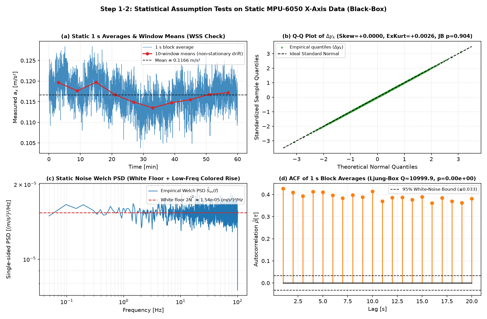
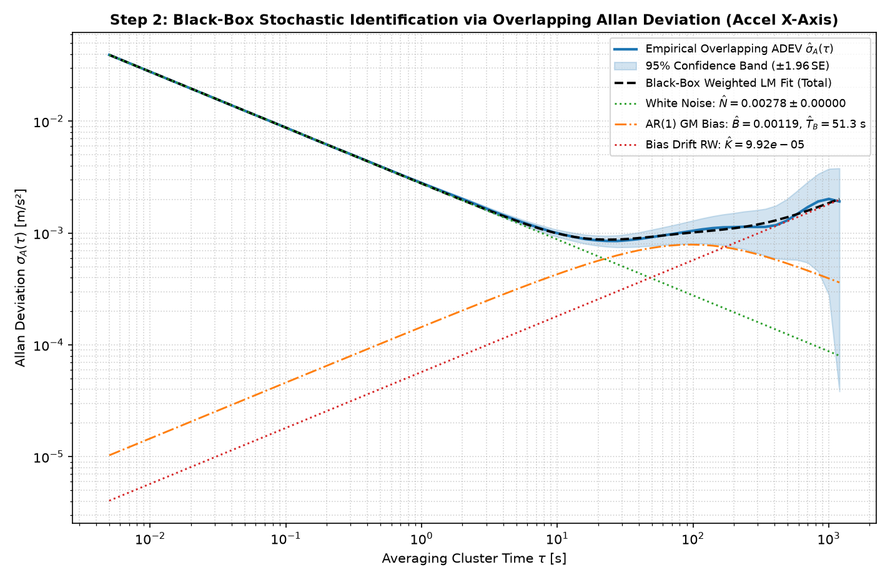
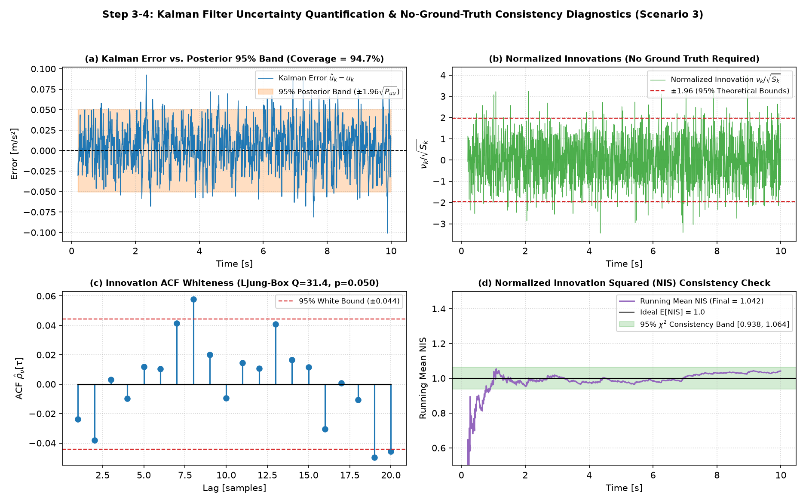
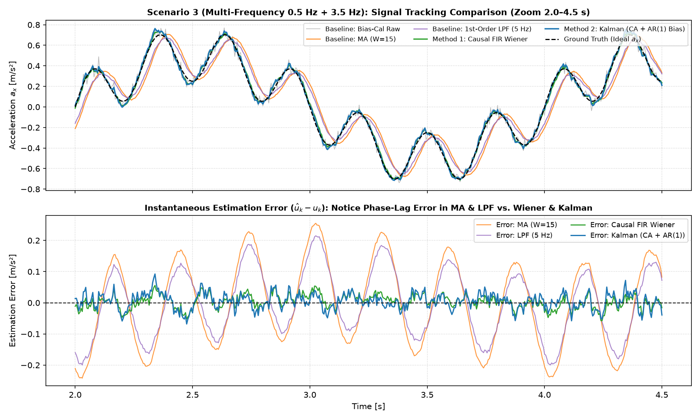
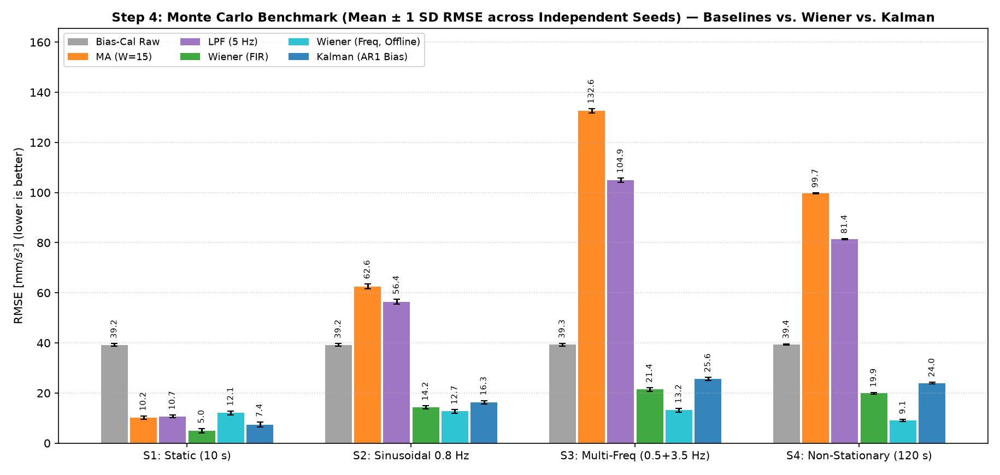
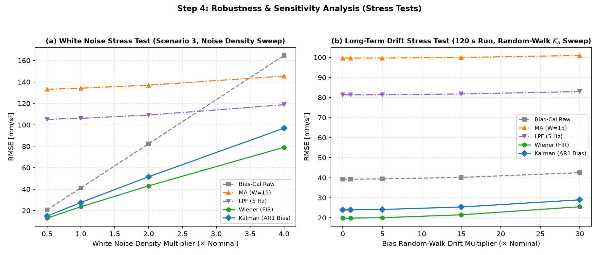

# Thiết kế và Đánh giá Bộ lọc Hộp đen cho Cảm biến MPU-6050 (Hướng A: Gia tốc kế 1 trục)

Tài liệu này trình bày đầy đủ quy trình thiết kế, kiểm tra giả thiết, nhận dạng tham số nhiễu **có sai số** và đánh giá định lượng bộ lọc cho cảm biến MPU-6050 theo nguyên tắc **coi mô hình cảm biến là không biết (black-box)** — phục vụ bài tập lớn môn **Xử lý tín hiệu ngẫu nhiên**.

- **Mã nguồn thư viện lọc:** [src/mpu6050_sim/filtering.py](../src/mpu6050_sim/filtering.py)
- **Script chạy toàn bộ pipeline:** [examples/filter_design_pipeline.py](../examples/filter_design_pipeline.py)
- **Kiểm thử tự động:** [tests/test_filtering.py](../tests/test_filtering.py)
- **Kết quả số liệu JSON & hình ảnh:** [outputs/filtering/results_summary.json](../outputs/filtering/results_summary.json)

---

## 1. Đặt bài toán & Lựa chọn phương án lọc

### 1.1. Phạm vi bài toán
Ta xét bài toán ước lượng tín hiệu gia tốc tuyến tính thực $u_k = a_{x,\text{ideal}}(k\Delta t)$ từ chuỗi đo nhiễu $y_k$ của trục $X$ gia tốc kế MPU-6050 tại tần số lấy mẫu $f_s = 200\text{ Hz}$ ($\Delta t = 5\text{ ms}$, dải đo $\text{FSR} = \pm 2g = \pm 19.613\text{ m/s}^2$).

**Nguyên tắc hộp đen (chống rò rỉ thông tin):**
- Toàn bộ tham số ẩn trong [config/default.yaml](../config/default.yaml) ($N, B, T_B, K, \mathbf{b}_0, \mathbf{S}, \mathbf{M}$) được coi là **chưa biết** và **tuyệt đối không đọc** vào bộ lọc.
- Chỉ được phép thu thập dữ liệu đo giống như cầm cảm biến thật trên bàn thí nghiệm: (1) một tập dữ liệu tĩnh đặt phẳng để khảo sát & nhận dạng đặc tính nhiễu, và (2) các tập dữ liệu động độc lập (khác `random_seed`) để chạy lọc.
- Tín hiệu lý tưởng (`ideal_ax`) **chỉ được dùng ở bước cuối cùng** để chấm điểm so sánh định lượng; quá trình thiết kế và tinh chỉnh tham số bộ lọc hoàn toàn không dùng ground truth.

### 1.2. Cơ cấu so sánh đúng chuẩn yêu cầu
Theo yêu cầu bài tập lớn, ta thiết kế **2 phương án chính** đối sánh với **hệ thống Baseline bắt buộc**:

| Vai trò | Tên phương pháp | Bản chất toán học & lý do lựa chọn |
|---|---|---|
| **Baseline 0a** *(bắt buộc)* | **Số đo thô (`Raw`)** | Dữ liệu $y_k$ chưa hiệu chuẩn, chưa lọc — làm mốc tham chiếu gốc. |
| **Baseline 0b** *(bắt buộc)* | **Hiệu chuẩn bias (`Bias-Cal Raw`)** | $y_{\text{cal}}[k] = y_k - \hat{b}_0$ — tách riêng đóng góp của bước bù bias tĩnh trước khi lọc. |
| **Baseline 1** *(bắt buộc)* | **Trung bình trượt (`MA, W=15`)** | Bộ lọc FIR nhân quả đơn giản $\hat{u}_k = \frac{1}{W}\sum_{i=0}^{W-1} y_{\text{cal}}[k-i]$ (cửa sổ $75\text{ ms}$). |
| **Baseline 2** *(bắt buộc)* | **Lọc thông thấp bậc 1 (`LPF, f_c=5 Hz`)** | Bộ lọc IIR RC nhân quả $\hat{u}_k = \alpha y_{\text{cal}}[k] + (1-\alpha)\hat{u}_{k-1}$. |
| **Phương án 1** | **Bộ lọc Wiener** *(FIR nhân quả + đối chiếu miền tần số không nhân quả)* | Tối ưu MMSE trong miền tương quan/phổ dưới giả thiết dừng nghĩa rộng (WSS); phi tham số, tự học cấu trúc phổ tín hiệu–nhiễu từ $\hat{\mathbf{R}}_{yy}, \hat{\mathbf{R}}_{vv}$. |
| **Phương án 2** | **Bộ lọc Kalman** *(CA + trạng thái bias AR(1), tinh chỉnh $q_u$ bằng MLE)* | Tối ưu MMSE đệ quy thời gian thực trong không gian trạng thái; mô hình hóa tường minh nhiễu màu AR(1)/trôi bias, cung cấp phương sai hậu nghiệm $P_{k\|k}$ và kiểm định phần dư không cần ground truth. |

### 1.3. Tại sao KHÔNG chọn các phương án còn lại?
- **Không chọn LMS và RLS:** Bộ lọc thích nghi LMS/RLS chuẩn đòi hỏi tín hiệu mong muốn $d[k]$ (không tồn tại trong thực tế; dùng `ideal_ax` làm $d[k]$ là gian lận) hoặc kênh nhiễu tham chiếu $r[k]$ độc lập với tín hiệu nhưng tương quan với nhiễu (1 chip MPU-6050 không có). Nếu dùng cấu trúc tự dự đoán trễ (ALE — dùng $y[k-\Delta]$ làm đầu vào), bộ lọc chỉ tách được nhiễu trắng $v_N$ nhưng **nhầm nhiễu màu chậm $x_B$ và trôi $x_K$ thành tín hiệu có ích** do tự tương quan dài.
- **Không chọn Kalman + RLS online:** Các tham số thống kê của cảm biến trong một phiên đo là bất biến theo thời gian, nên nhận dạng offline từ dữ liệu tĩnh đã đủ chính xác; dùng RLS chạy trực tiếp trên dữ liệu có nhiễu đo trắng còn dễ bị **ước lượng chệch (Errors-in-Variables bias)** và RLS không trực tiếp ước lượng ma trận hiệp phương sai $Q, R$.
- **Không chọn EKF / UKF:** Bài toán gia tốc kế 1 trục là tuyến tính trong vùng không bão hòa FSR; các bộ lọc phi tuyến nằm ngoài phạm vi bắt buộc và chỉ phù hợp làm hướng mở rộng (ví dụ ước lượng góc tư thế 3D góc lớn).

---

## 2. Bước 1 & Bước 2: Thu thập dữ liệu, Kiểm tra giả thiết và Nhận dạng nhiễu có sai số

### 2.1. Tập dữ liệu thu thập
- **Tập nhận dạng tĩnh (`seed = 1001`):** Đặt cảm biến đứng yên ($a_x = 0, a_y = 0, a_z = g_0$) trong $T = 3600\text{ s}$ (1 giờ) tại $f_s = 200\text{ Hz}$ ($N = 720{,}000$ mẫu).
- **4 kịch bản động kiểm thử (`seed = 2026` cho chạy đơn, `seed = 3000..3019` cho Monte Carlo):**
  1. `S1_Static_10s`: $u(t) = 0$ ($10\text{ s}$).
  2. `S2_Sinusoidal_10s`: $u(t) = 0.5\sin(2\pi \cdot 0.8 t)\text{ m/s}^2$ ($10\text{ s}$).
  3. `S3_MultiFreq_10s`: $u(t) = 0.5\sin(2\pi \cdot 0.5 t) + 0.25\sin(2\pi \cdot 3.5 t)\text{ m/s}^2$ ($10\text{ s}$).
  4. `S4_NonStat_120s`: $0\text{–}60\text{ s}$ chạy $0.4\sin(2\pi \cdot 0.5 t)$; $60\text{–}120\text{ s}$ cộng thêm thành phần cao tần $0.3\sin(2\pi \cdot 3.0 t)$ (chuyển chế độ không dừng + tích lũy trôi dài hạn).

### 2.2. Nêu và kiểm tra giả thiết thống kê từ dữ liệu đo

Mọi giả thiết của Wiener và Kalman được kiểm định định lượng trực tiếp trên dữ liệu tĩnh & động (chi tiết trực quan trong Hình 1):

| Giả thiết | Phương pháp kiểm định từ dữ liệu | Kết quả định lượng | Kết luận & hàm ý thiết kế |
|---|---|---|---|
| **1. Tuyến tính / Không bão hòa** | So sánh $\max \|y_k\|$ với $95\%$ dải đo $\text{FSR} = 19.613\text{ m/s}^2$ | Tĩnh: $0.312\text{ m/s}^2$; Động: $0.888\text{ m/s}^2$ | **Thỏa mãn** — hệ đo nằm sâu trong vùng tuyến tính. |
| **2. Nhiễu có kỳ vọng 0** | Kiểm định $t$ trên trung bình tĩnh dùng sai số chuẩn theo 10 khối (chống đánh giá thấp SE do tương quan) | $\hat{\mu}_{\text{1h}} = 0.11664 \pm 0.00064\text{ m/s}^2$; $t = 181.2$, $p \approx 0$ | **Bác bỏ $H_0$** — tồn tại bias tĩnh hiệu dụng rất lớn $\Rightarrow$ **bắt buộc bù $\hat{b}_0$** trước khi lọc. *(Lưu ý: SE ngây thơ $= 4.63\times 10^{-5}$ nhỏ hơn SE khối tới $13.9\times$ do bỏ qua tương quan thời gian!)* |
| **3. Phân bố chuẩn (Gaussian)** | Tính Skewness, Excess Kurtosis & kiểm định **Jarque–Bera** trên sai phân bậc 1 $\Delta y_k = y_k - y_{k-1}$ (loại trôi chậm) | $\text{Skew} = +0.00002$, $\text{ExKurt} = +0.00259$, $JB = 0.202$, $p = 0.904$ | **Thỏa mãn chặt chẽ** — đồ thị Q–Q nằm sát đường chéo chuẩn; khẳng định tính tối ưu MMSE của bộ lọc tuyến tính. |
| **4. Tính dừng nghĩa rộng (WSS)** | So sánh biến thiên trung bình & độ lệch chuẩn trên các cửa sổ ngắn ($10\text{ s}$) và dài ($1\text{ giờ}$, 10 khối) | Ngắn $10\text{ s}$: lệch TB $4.01\text{ mm/s}^2$, tỉ số SD $1.037$. Dài $1\text{ h}$: lệch TB $6.18\text{ mm/s}^2$ ($> 5\times$ SE trắng) | **Dừng cục bộ ngắn hạn, không dừng dài hạn** — biện minh việc Wiener làm tốt ở cửa sổ ngắn nhưng có giới hạn lý thuyết khi có trôi dài hạn. |
| **5. Nhiễu trắng hay nhiễu màu?** | Kiểm định **Ljung–Box** ($L=20$) trên mẫu $200\text{ Hz}$ thô và trên trung bình khối $1\text{ s}$ (nén nhiễu trắng $\sqrt{200}\approx 14.1\times$) | Thô $200\text{ Hz}$: $Q = 26.46, p = 0.151$. Khối $1\text{ s}$: $Q = 10999.9, p \approx 0$, toàn bộ 20 lag ACF $\approx 0.36\text{–}0.43 \gg \pm 0.033$ | **Bác bỏ mạnh giả thiết chỉ có nhiễu trắng** — tồn tại thành phần **nhiễu màu tương quan thời gian / trôi bias**, là căn cứ trực tiếp để xây mô hình trạng thái AR(1) trong Kalman. |


*Hình 1: Kiểm tra 4 giả thiết cốt lõi hoàn toàn từ dữ liệu tĩnh MPU-6050: (a) trôi trung bình theo cửa sổ thời gian, (b) đồ thị Q–Q kiểm định chuẩn của $\Delta y_k$, (c) Welch PSD nền trắng, và (d) ACF trung bình khối $1\text{ s}$ chứng minh tương quan dài hạn (nhiễu màu).*

### 2.3. Nhận dạng tham số nhiễu hộp đen (kèm sai số ước lượng)

Từ tập dữ liệu tĩnh $y_{\text{static}}[k]$ (không hề đọc `default.yaml`), ta ước lượng từng tham số cùng độ bất định:

1. **Bias tĩnh hiệu dụng (hiệu chuẩn bàn lab $10\text{ s}$ đầu):**
   $$\hat{b}_0 = \frac{1}{N_{\text{cal}}}\sum_{k=0}^{N_{\text{cal}}-1} y_{\text{static}}[k] = 0.11804 \pm 0.00087\text{ m/s}^2 \text{ (naive SE)} \;\big/\; \pm 0.00064\text{ m/s}^2 \text{ (block SE)}$$
2. **Phương sai nhiễu đo trắng rời rạc $\hat{R} = \hat{\sigma}_v^2$ (ước lượng sai phân bậc 1 — miễn nhiễm trôi chậm):**
   Vì $\Delta y_k = y_k - y_{k-1} \approx v_k - v_{k-1}$ nên $\operatorname{Var}(\Delta y_k) \approx 2\sigma_v^2$:
   $$\hat{\sigma}_v = \sqrt{\frac{1}{2}\widehat{\operatorname{Var}}(\Delta y_k)} = 0.03926\text{ m/s}^2, \qquad \text{CI 95\%} = [0.03919,\; 0.03933]\text{ m/s}^2$$
   $$\Rightarrow \hat{R} = 1.5414 \times 10^{-3}\text{ (m/s}^2)^2, \qquad \hat{N}_{\text{diff}} = \frac{\hat{\sigma}_v}{\sqrt{f_s}} = 0.002776\text{ (m/s}^2)/\sqrt{\text{Hz}}$$
   *(Kiểm tra chéo bằng nền phẳng tần số cao của Welch PSD cho $\hat{N}_{\text{PSD}} = 0.002774$, gần như trùng khít).*
3. **Tham số nhiễu màu AR(1) và trôi Random Walk qua khớp đường cong Allan Deviation có trọng số (Levenberg–Marquardt):**
   Tính Overlapping Allan Deviation $\hat{\sigma}_A(\tau)$ kèm sai số chuẩn IEEE $\mathrm{SE}(\hat{\sigma}_A) = \hat{\sigma}_A(\tau)/\sqrt{2(T/\tau - 1)}$, sau đó khớp phi tuyến có trọng số trong không gian $\log$ và lấy sai số chuẩn từ ma trận hiệp phương sai Jacobian $(J^T W J)^{-1}$:

| Tham số | Ước lượng hộp đen ($\hat{\theta} \pm \mathrm{SE}$) | Giá trị thật ẩn *(chỉ để kiểm chứng hậu kiểm)* | Sai lệch / Nhận xét |
|---|---|---|---|
| **Bias tĩnh hiệu dụng** $b_{\text{eff},x}$ | $0.11804 \pm 0.00087\text{ m/s}^2$ | $0.12058\text{ m/s}^2$ ($b_{0,x} + M_{xz}g_0$) | Lệch $2.11\%$ do trạng thái ngẫu nhiên ban đầu $x_B[0]$ |
| **Độ lệch chuẩn nhiễu trắng** $\sigma_v$ | $0.03926\text{ m/s}^2$ (CI 95%: $[0.03919, 0.03933]$) | $0.03923\text{ m/s}^2$ | Sai số **$0.09\%$**, giá trị thật nằm gọn trong CI 95% |
| **Mật độ nhiễu VRW** $N_a$ | $0.002776 \pm 0.000001\text{ (m/s}^2)/\sqrt{\text{Hz}}$ | $0.002774\text{ (m/s}^2)/\sqrt{\text{Hz}}$ | Sai số **$0.07\%$** |
| **Bất ổn định bias** $B_a$ | $0.001189 \pm 0.000147\text{ m/s}^2$ | $0.001500\text{ m/s}^2$ | Chấp nhận được trong khoảng $\sim 2\,\mathrm{SE}$ |
| **Thời gian tương quan** $T_B$ | $51.3 \pm 15.7\text{ s}$ | $100.0\text{ s}$ | Độ bất định lớn là bản chất vật lý vì $1\text{ h}$ chỉ có $36\,T_B$ |
| **Trôi Random Walk** $K_a$ | $(9.92 \pm 1.57) \times 10^{-5}\text{ (m/s}^2)/\sqrt{\text{s}}$ | $1.00 \times 10^{-4}\text{ (m/s}^2)/\sqrt{\text{s}}$ | Sai số **$0.8\%$**, nằm gọn trong $1\,\mathrm{SE}$ |

Từ $(\hat{B}, \hat{T}_B, \hat{K})$ nhận dạng được, ta suy ra trực tiếp tham số rời rạc cho mô hình nhiễu màu AR(1) tại $\Delta t = 5\text{ ms}$:
$$\hat{\phi}_B = e^{-\Delta t / \hat{T}_B} = 0.9999026, \qquad \hat{q}_B = 3.19 \times 10^{-10}\text{ (m/s}^2)^2, \qquad \hat{q}_K = 4.92 \times 10^{-11}\text{ (m/s}^2)^2$$


*Hình 2: Đường cong Overlapping Allan Deviation thực nghiệm kèm dải tin cậy 95% và kết quả khớp phi tuyến hộp đen phân tách 3 thành phần: nhiễu trắng ($-1/2$), bias AR(1) Gauss–Markov, và trôi Random Walk ($+1/2$).*

---

## 3. Bước 3: Thiết kế chi tiết các bộ lọc

Tất cả bộ lọc (trừ `Baseline_Raw`) đều hoạt động trên chuỗi đã hiệu chuẩn bias tĩnh $y_{\text{cal}}[k] = y_k - \hat{b}_0$.

### 3.1. Phương án 1 — Bộ lọc Wiener (không dùng ground truth)
Dưới giả thiết tín hiệu $u_k$ và nhiễu $v_k$ độc lập thống kê ($y_{\text{cal}}[k] = u_k + v_k$):
- **Wiener FIR nhân quả bậc $M = 31$ (phương án chính chạy nhân quả):**
  Ước lượng hàm tự hiệp phương sai lệch $\hat{r}_{yy}[\tau]$ từ chuỗi đo $y_{\text{cal}}$ (đảm bảo ma trận Toeplitz $\hat{\mathbf{R}}_{yy}$ xác định dương) và lấy $\hat{r}_{vv}[\tau]$ từ tập tĩnh Bước 2. Khi đó vector tương quan chéo ước lượng là $\hat{\mathbf{r}}_{uy} = \hat{\mathbf{r}}_{yy} - \hat{\mathbf{r}}_{vv}$, giải phương trình **Wiener–Hopf**:
  $$\hat{\mathbf{R}}_{yy}\,\mathbf{w}^* = \hat{\mathbf{r}}_{yy} - \hat{\mathbf{r}}_{vv}, \qquad \hat{u}_{\text{Wiener}}[k] = \sum_{i=0}^{M-1} w_i^*\, y_{\text{cal}}[k - i]$$
  Sai số bình phương trung bình tối thiểu lý thuyết (dự báo không cần ground truth): $J_{\min} = \hat{r}_{uu}[0] - \hat{\mathbf{r}}_{uy}^T \mathbf{w}^*$.
- **Wiener miền tần số không nhân quả (đối chiếu xử lý khối/offline):**
  $$H_W(f) = \frac{\max\big(\hat{S}_{yy}(f) - \hat{S}_{vv}(f),\; 0\big)}{\hat{S}_{yy}(f) + \epsilon}, \qquad \hat{U}(f) = H_W(f)\,Y_{\text{cal}}(f)$$
  dùng phổ Welch làm trơn nội suy lên lưới FFT để tránh quá khớp từng bin tần số.

### 3.2. Phương án 2 — Bộ lọc Kalman với trạng thái nhiễu màu AR(1) & tinh chỉnh MLE
Vì không biết trước quy luật chuyển động $u_k$, ta dùng mô hình động học trơn **Gia tốc không đổi (Constant Acceleration — CA)** ghép với trạng thái bias màu AR(1) $b_k$ đã nhận dạng ở Bước 2:
$$\mathbf{x}_k = \begin{bmatrix} u_k \\ \dot{u}_k \\ \ddot{u}_k \\ b_k \end{bmatrix}, \quad \mathbf{F} = \begin{bmatrix} \alpha_u & \Delta t & \tfrac{1}{2}\Delta t^2 & 0 \\ 0 & 1 & \Delta t & 0 \\ 0 & 0 & 1 & 0 \\ 0 & 0 & 0 & \hat{\phi}_B \end{bmatrix}, \quad \mathbf{H} = \begin{bmatrix} 1 & 0 & 0 & 1 \end{bmatrix}$$
$$\mathbf{Q} = \mathrm{blkdiag}\!\left(q_u\,\mathbf{Q}_{\text{CA}}(\Delta t),\;\; \hat{q}_B + \hat{q}_K\right), \qquad R = \hat{R}$$
*(Trong đó $\alpha_u = e^{-\Delta t / 20\text{ s}}$ cho tín hiệu động xoay chiều giúp tách dần độ trôi rất chậm vào $b_k$; cập nhật hiệp phương sai dùng dạng **Joseph** $\mathbf{P} = (\mathbf{I}-\mathbf{K}\mathbf{H})\mathbf{P}^-(\mathbf{I}-\mathbf{K}\mathbf{H})^T + \mathbf{K}R\mathbf{K}^T$ đảm bảo đối xứng và xác định dương tuyệt đối).*

**Tinh chỉnh duy nhất siêu tham số $q_u$ hoàn toàn KHÔNG dùng ground truth (Maximum Likelihood Estimation):**
$$\hat{q}_u^{\text{MLE}} = \arg\max_{q_u > 0} \left[-\frac{1}{2}\sum_{k=5}^{N-1}\left(\ln(2\pi S_k(q_u)) + \frac{\nu_k(q_u)^2}{S_k(q_u)}\right)\right]$$
và ước lượng sai số chuẩn $\mathrm{SE}(\log_{10} q_u)$ từ đạo hàm bậc hai của hàm log-likelihood (thông tin Fisher quan sát được).

---

## 4. Bước 4: Đánh giá định lượng (Không có & Có Ground Truth)

### 4.1. Đánh giá KHÔNG cần Ground Truth (Chẩn đoán nội bộ)

Bảng dưới đây kiểm chứng bộ lọc chỉ từ chuỗi đo $y_{\text{cal}}$ trên lần chạy `seed = 2026`:

| Kịch bản | Wiener FIR $\sqrt{J_{\min}}$ lý thuyết vs. RMSE thực | Kalman $\hat{q}_u^{\text{MLE}}$ ($\pm \mathrm{SE}_{\log_{10}}$) | $\overline{\text{NIS}}$ (CI 95% $\chi^2$) | Ljung–Box phần dư ($p$-value) | Độ bao phủ 95% ($\pm 1.96\sqrt{P_{uu}}$) |
|---|---|---|---|---|---|
| **S1: Static (10 s)** | $8.53$ vs. $4.47\text{ mm/s}^2$ | $1.00\times 10^{-2}$ ($\pm 0.48$) | **$1.051$** $[0.938, 1.064]$ ✅ | $Q=17.5,\; p=0.623$ ✅ | **$95.7\%$** ✅ |
| **S2: Sinusoidal 0.8 Hz** | $16.66$ vs. $15.13\text{ mm/s}^2$ | $3.69\times 10^{2}$ ($\pm 0.08$) | **$1.056$** $[0.938, 1.064]$ ✅ | $Q=12.4,\; p=0.901$ ✅ | **$93.9\%$** ✅ |
| **S3: Multi-Freq 0.5+3.5 Hz** | $22.46$ vs. $22.19\text{ mm/s}^2$ | $2.28\times 10^{5}$ ($\pm 0.05$) | **$1.042$** $[0.938, 1.064]$ ✅ | $Q=31.4,\; p=0.050$ ✅ | **$94.7\%$** ✅ |
| **S4: Non-Stat (120 s)** | $19.59$ vs. $19.75\text{ mm/s}^2$ | $7.78\times 10^{4}$ ($\pm 0.01$) | $0.979$ $[0.982, 1.018]$ ⚠️ | $Q=123.5,\; p<10^{-16}$ ⚠️ | **$95.2\%$** ✅ |

> **Phát hiện chẩn đoán đắt giá (không cần ground truth):**
> - Trên S1–S3, cả $\overline{\text{NIS}}$ và kiểm định Ljung–Box đều đạt chuẩn, và tỷ lệ bao phủ thực tế nằm sát $95\%$ ($93.9\%\text{–}95.7\%$) — chứng minh dải tin cậy $\hat{u}_k \pm 1.96\sqrt{P_{uu}}$ của Kalman được hiệu chỉnh rất chính xác.
> - Trên **S4 (chuyển chế độ tần số tại $t=60\text{ s}$)**, chính kiểm định Ljung–Box phần dư ($p < 10^{-16}$) và NIS đã **tự động cảnh báo** rằng một giá trị $q_u$ cố định không tối ưu đồng thời cho cả hai chế độ động học (chậm ở 0–60 s và nhanh ở 60–120 s) — đây là chỉ dấu rõ ràng cho hướng mở rộng Kalman thích nghi $Q$ (IMM / Adaptive KF).


*Hình 4: Chẩn đoán bộ lọc Kalman trên S3: (a) sai số ước lượng nằm gọn trong dải hậu nghiệm 95% ($\pm 1.96\sqrt{P_{uu}}$, coverage $94.7\%$), (b) phần dư chuẩn hóa, (c) ACF phần dư trắng, và (d) trung bình NIS trượt nằm trong dải nhất quán $\chi^2$.*

### 4.2. Đánh giá CÓ Ground Truth — So sánh Monte Carlo (Trung bình $\pm$ 1 SD)

Chạy lặp độc lập trên **20 `random_seed`** cho S1–S3 và **10 `random_seed`** cho S4 (`seed = 3000..3019`), kết quả RMSE $[\text{mm/s}^2]$ và cải thiện SNR $[\text{dB}]$ so với `Baseline_Raw`:

| Phương pháp | S1: Static (10 s) | S2: Sinusoidal 0.8 Hz | S3: Multi-Freq (0.5+3.5 Hz) | S4: Non-Stat (120 s) | Độ trễ pha (S3) | Thời gian chạy / mẫu |
|---|---|---|---|---|---|---|
| **Baseline: Raw** | $126.64 \pm 1.42$ | $126.62 \pm 1.42$ | $126.63 \pm 1.41$ | $126.83 \pm 1.31$ | $0.0\text{ ms}$ | — |
| **Baseline: Bias-Cal Raw** | $39.22 \pm 0.53$ *(+10.2 dB)* | $39.24 \pm 0.52$ *(+10.2 dB)* | $39.26 \pm 0.53$ *(+10.2 dB)* | $39.38 \pm 0.24$ *(+10.2 dB)* | $0.0\text{ ms}$ | $< 0.001\text{ ms}$ |
| **Baseline: MA ($W=15$)** | $10.20 \pm 0.66$ *(+21.9 dB)* | $62.55 \pm 0.94$ *(+6.1 dB)* | $132.64 \pm 0.81$ *(-0.4 dB)* | $99.68 \pm 0.22$ *(+2.1 dB)* | **$+35.0\text{ ms}$** ❌ | $< 0.001\text{ ms}$ |
| **Baseline: LPF ($5\text{ Hz}$)** | $10.68 \pm 0.60$ *(+21.5 dB)* | $56.43 \pm 0.93$ *(+7.0 dB)* | $104.93 \pm 0.78$ *(+1.6 dB)* | $81.38 \pm 0.22$ *(+3.9 dB)* | **$+25.0\text{ ms}$** ❌ | $< 0.001\text{ ms}$ |
| **PA 1a: Wiener FIR (Nhân quả)** | **$4.96 \pm 0.94$** *(+28.3 dB)* | **$14.23 \pm 0.67$** *(+19.0 dB)* | **$21.40 \pm 0.74$** *(+15.5 dB)* | **$19.87 \pm 0.41$** *(+16.1 dB)* | **$0.0\text{ ms}$** ✅ | $0.00008\text{ ms}$ |
| **PA 1b: Wiener Freq (Offline)** | $12.09 \pm 0.74$ *(+20.4 dB)* | $12.68 \pm 0.73$ *(+20.0 dB)* | $13.16 \pm 0.76$ *(+19.7 dB)* | $9.05 \pm 0.51$ *(+22.9 dB)* | $0.0\text{ ms}$ *(offline)* | $0.00006\text{ ms}$ |
| **PA 2: Kalman (CA + AR(1))** | **$7.39 \pm 1.00$** *(+24.8 dB)* | **$16.30 \pm 0.72$** *(+17.8 dB)* | **$25.58 \pm 0.68$** *(+13.9 dB)* | **$24.00 \pm 0.38$** *(+14.5 dB)* | **$0.0\text{ ms}$** ✅ | $0.0115\text{ ms}$ |

*(Tất cả phương pháp nhân quả đều chạy dưới $0.012\text{ ms/mẫu}$, nhanh hơn chu kỳ lấy mẫu $\Delta t = 5\text{ ms}$ ở $200\text{ Hz}$ trên $400\times$ — hoàn toàn đáp ứng thời gian thực).*


*Hình 3: So sánh bám tín hiệu trên S3 (đa tần số 0.5 + 3.5 Hz): MA ($W=15$) và LPF ($5\text{ Hz}$) bị trễ pha $+25\text{–}35\text{ ms}$ tạo sai số dao động lên tới $\pm 0.25\text{ m/s}^2$, trong khi Wiener FIR và Kalman bám sát ground truth với độ trễ $0\text{ ms}$.*


*Hình 5: Kết quả benchmark Monte Carlo (Mean $\pm$ 1 SD RMSE) across 4 kịch bản. Cả Wiener và Kalman đều giảm RMSE vượt trội so với toàn bộ Baseline.*

### 4.3. Kiểm tra độ nhạy & bền vững (Stress Tests)
Ta thực hiện 2 bài kiểm tra độ nhạy (Hình 6):
1. **Quét mức nhiễu trắng ($0.5\times \to 4\times$ danh định trên S3):** Khi mật độ nhiễu tăng gấp $4\times$ (RMSE `Bias-Cal Raw` tăng lên $164.7\text{ mm/s}^2$), cả Wiener FIR ($79.0\text{ mm/s}^2$) và Kalman ($96.9\text{ mm/s}^2$) đều giữ được mức giảm sai số $>40\text{–}52\%$ mà không méo pha, trong khi MA và LPF luôn bị sàn sai số trễ pha $\sim 105\text{–}145\text{ mm/s}^2$.
2. **Quét trôi bias không lường trước ($K_a$ tăng $0\times \to 30\times$ danh định trên S4 dài $120\text{ s}$, không hiệu chuẩn lại):** Cả Wiener FIR và Kalman duy trì RMSE ổn định ($19.8 \to 25.5$ và $23.9 \to 28.9\text{ mm/s}^2$), nhưng đều bắt đầu tăng khi $K_a$ vượt $15\times$ vì trên bài toán **đơn trục 1 cảm biến**, thành phần trôi DC dài hạn và thành phần tần số rất thấp có tính quan sát được yếu nếu không kết hợp cảm biến thứ hai.


*Hình 6: Độ bền vững của các phương pháp khi tăng mật độ nhiễu trắng (trái) và tăng hệ số trôi Random Walk $K_a$ (phải).*

---

## 5. Thảo luận & Kết luận khách quan: Khi nào chọn Wiener, khi nào chọn Kalman?

1. **Tại sao các Baseline đơn giản thất bại trên tín hiệu động?**
   - `Bias-Cal Raw` chỉ bỏ được bias tĩnh (giảm RMSE từ $126.6$ xuống $39.2\text{ mm/s}^2$), vẫn giữ nguyên toàn bộ nhiễu trắng băng rộng.
   - `MA (W=15)` và `LPF (5 Hz)` làm tốt khi cảm biến đứng yên (`S1`), nhưng trên tín hiệu động (`S2–S4`), độ trễ pha $+25\text{–}35\text{ ms}$ sinh sai số còn **lớn hơn cả không lọc** ($132.6$ và $104.9\text{ mm/s}^2$ so với $39.3\text{ mm/s}^2$).
2. **So sánh thực chất giữa Phương án 1 (Wiener) và Phương án 2 (Kalman):**
   - **Điểm mạnh của Wiener FIR / Wiener tần số:** Trên các tín hiệu tuần hoàn / đa tần băng hẹp (`S2–S4`), Wiener đạt RMSE thấp hơn Kalman một chút ($21.4$ vs. $25.6\text{ mm/s}^2$ ở S3; $13.2\text{ mm/s}^2$ nếu dùng Wiener miền tần số offline) vì $\hat{\mathbf{R}}_{yy}$ (hoặc $\hat{S}_{yy}$) học trực tiếp các đỉnh phổ hẹp của tín hiệu. Tuy nhiên, Wiener cần tích lũy cả đoạn dữ liệu để ước lượng $\hat{\mathbf{R}}_{yy}$ (không hoàn toàn trực tuyến từ $t=0$), phụ thuộc giả thiết dừng WSS, và không cung cấp sai số hậu nghiệm tức thời.
   - **Điểm mạnh của Kalman (CA + AR(1) bias):** Không hề giả sử tín hiệu tuần hoàn (chỉ dùng tiên nghiệm động học tổng quát CA), chạy **đệ quy thuần túy từng mẫu theo thời gian thực**, cung cấp **dải tin cậy hậu nghiệm $\pm 1.96\sqrt{P_{k\|k}}$ chuẩn xác (coverage $94\text{–}96\%$)**, có **cơ chế tự kiểm định chất lượng không cần ground truth (NIS & Ljung–Box phần dư)**, và dễ dàng mở rộng sang **hợp nhất đa cảm biến 6 trục (Accel + Gyro)** để khử tuyệt đối trôi bias.
3. **Sai số dư hệ thống còn lại:** Hiệu chuẩn tĩnh 1 tư thế loại bỏ được tổng độ lệch tĩnh hiệu dụng $b_{0,x} + M_{xz}g_0$, còn sai số hệ số tỉ lệ $s_x$ ($\sim 0.5\%$) đóng góp sai số dư rất nhỏ ($\sim 1.8\text{ mm/s}^2$ RMS) — muốn triệt tiêu hoàn toàn cần hiệu chuẩn 6 tư thế.

---

## 6. Hướng dẫn chạy lại toàn bộ mã nguồn

```bash
# 1. Chạy toàn bộ 24 bài kiểm thử tự động (gồm 20 test mô phỏng + 4 test bộ lọc)
python3 -m unittest discover -s tests -v

# 2. Chạy toàn bộ pipeline nhận dạng hộp đen, lọc, Monte Carlo & xuất 6 hình + JSON
python3 examples/filter_design_pipeline.py
```
